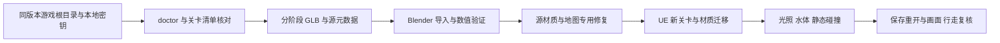

# Iceland 地图复现与导出工具说明

更新：2026-10-31。根据这次实际导出、修复和验证重写；原 `E:/Download/现状与思路.md` 是历史研究资料，旧失败结论不能直接当成当前状态。

## 阅读顺序

1. [完整复现教程](Iceland完整复现教程.md)：游戏包 → 分阶段导出 → Blender 几何/材质修复 → UE 新关卡 → 光照、水体和碰撞；区分从头重建、从当前修复版继续、维护成品三条路线。
2. [踩坑与排查手册](踩坑与排查手册.md)：19 类已遇问题的现象、根因、修复方法、验证和不可重复的错误操作。
3. [AI 地图处理操作说明](AI地图处理操作说明.md)：交给下一位 AI 的状态核对、source ID、断点恢复、验收规则及真实近似边界。
4. [导出软件修正版使用说明](软件修正版使用说明.md)：本次软件改动、配置、GUI、CLI、Blender 验证入口、测试和限制。

## 当前成品与新导出的区别

当前已修复成品位于 `out/Iceland/revised/Iceland_ground_detail_helpers_fixed.blend`；UE 关卡是 `/Game/Maps/Iceland_Blender_20261031`。源对象 16,792，导入时 2,134 个网格资产、639 个兼容材质实例，后续另有水体和光照资产。数字是该次源版本与修复范围的记录，不是以后所有版本都必须相同。

软件修正版解决了配置、组件材质覆盖、源隐藏/碰撞元数据、共享网格覆盖串接、同名关卡分块以及 Blender 验证入口的问题。它仍是基础导出器，**GUI 点一次导出不会自动复现全部 Iceland 专用修复**。原游戏完整 shader、GI2D/PRT、水体交互、浮力及动态天气仍有不可恢复或兼容近似部分。

地图专用验证报告仍在 `out/Iceland/` 的各阶段目录；从源码目录维护当前工程时可按教程查阅。便携软件包不会把几十 GB 的成品、游戏包或密钥打包进去。相关 C# 审计工具、Python 脚本及测试随源码说明提供，硬编码路径必须先核对。
